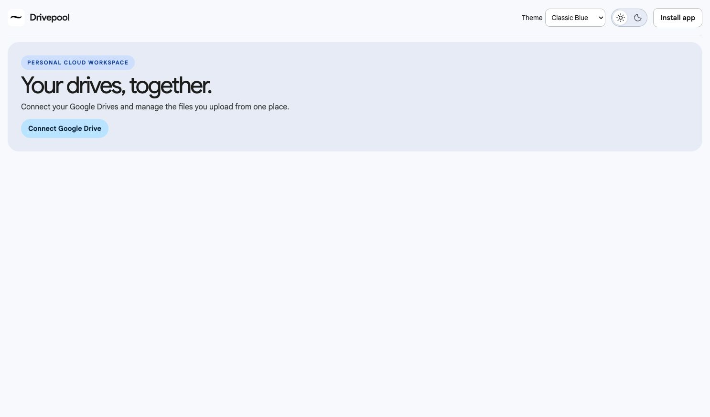
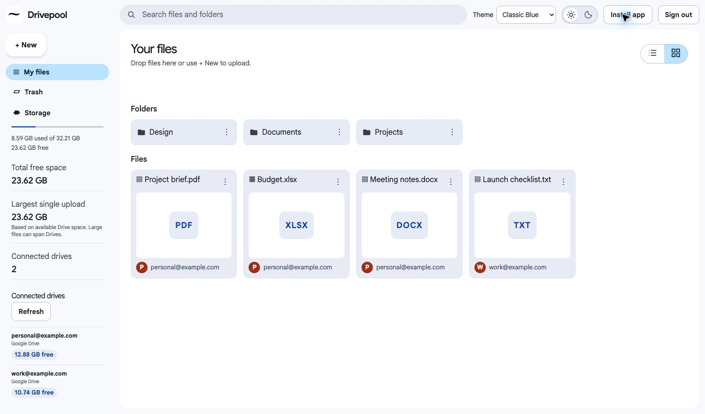
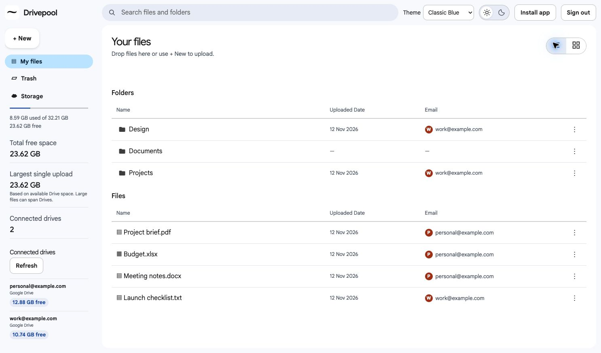

# Drivepool

Drivepool gives you one workspace for files across multiple personal Google Drive accounts. It shows your combined available space and places each upload in the connected account with the most free space that can fit the whole file.

## What you can do

- Sign in with Google and connect additional accounts through OAuth.
- View free space per Drive, combined free space, and the largest possible single upload.
- Upload a file and see which Drive received it.
- Download your Drivepool uploads from one list.
- Install the web app from a supported browser on an HTTPS deployment.

## App screenshots

Screenshots of the current interface, captured locally with demo accounts and sample files. No personal account data is shown.

### Landing and sign-in

Connect your Google Drive from the landing page to open your workspace.

### Workspace — grid view

After sign-in, browse folders and file cards, search your workspace, and view combined storage and connected Drives in the sidebar.

### Workspace — list view

Switch to list view to see file and folder names, upload dates, and account email badges.

## How it works

| Component | Role |
| --- | --- |
| Node.js 24+ | Serves the web app, handles OAuth, chooses a Drive, and streams transfers. |
| Google Drive API | Reads quota and stores or retrieves files in the linked Google accounts. |
| SQLite | Stores local sessions and linked accounts for development. |
| Supabase Postgres | Stores sessions, OAuth state, and encrypted refresh tokens in a private schema on the hosted deployment. |
| GitHub and Render | GitHub holds the source. Render runs the Node service and provides an HTTPS URL. |

Drivepool requests the `drive.file` permission and lists files uploaded through the app. Each file stays in one Drive. Login is anchored to the first account, and the server checks workspace ownership on downloads. A connected secondary account does not act as a sign-in for that workspace.

## Run locally

Requires Node.js 24 or later. Run `npm ci` from the project root to install the pinned dependencies.

1. In [Google Cloud Console](https://console.cloud.google.com/), create a project and enable the Google Drive API.
2. Configure the Google OAuth consent screen. For an external app in Testing, add each Google account you will use as a test user.
3. Create an OAuth client of type **Web application**. Add the exact authorized redirect URI `http://localhost:3000/oauth/callback`.
4. Copy `.env.example` to `.env`. Put the OAuth client ID and secret in the matching fields. Generate `TOKEN_KEY` with `openssl rand -base64 32` and keep the same key across restarts.
5. Run `npm start`, then open [Drivepool on localhost](http://localhost:3000).

The first account you connect is your Drivepool sign-in account. Use **Connect another Google Drive** to add secondary accounts. When you sign out, use the first account to reopen the same workspace. Testing-mode Google refresh tokens can expire and require reconnecting.

## Try the workflow

1. Connect two personal Google accounts and compare the displayed free space for each.
2. Upload a small test file. The confirmation shows which account received it.
3. Download it from **Your files** and open it to verify the contents.
4. Sign out and sign in with a different primary account to confirm that the first workspace's files are absent.

Drivepool lists files uploaded through this app. One file must fit in one account. The interface reports unknown quota separately. An interrupted upload must be retried from the UI. Check the file list before retrying.

## Install on a phone

Deploy the Node server behind HTTPS at a domain you control. Set `APP_ORIGIN` to that HTTPS origin, register its `/oauth/callback` URI in Google Cloud, and mount `DATA_DIR` on a persistent volume. Use `HOST=0.0.0.0` and the platform's `PORT` when required. Run one server instance for this MVP. Configure your reverse proxy to stream request bodies and allow the file sizes and transfer times you intend to support.

Open the HTTPS website on your phone and select **Install app**. On iPhone, use Safari's **Share → Add to Home Screen**. This is the installable web version. A later native app can build on the backend routes, with mobile sign-in and sessions designed for that client.

[Google OAuth web server setup](https://developers.google.com/identity/protocols/oauth2/web-server) · [Google Drive permissions](https://developers.google.com/workspace/drive/api/guides/api-specific-auth)

## Deploy the free beta

1. Create a Free Supabase project for Drivepool. If both free project slots are occupied, free one only if you no longer need the project running. In the project's **Connect** dialog, copy the **Session pooler** Postgres URI on port 5432. Substitute the database password, URL-encoding it if needed.
2. Put the source in a private GitHub repository. The source ZIP contains only tracked deployment inputs. Keep the local `.env`, `data/` and `node_modules/` outside Git.
3. In Render, create a **Web Service**, connect that GitHub repository and choose **Free** and **Node**. Set the build command to `npm ci` and the start command to `npm start`. Use Node 24, and set `HOST=0.0.0.0`.
4. Set `APP_ORIGIN` to the exact HTTPS URL assigned by Render, without a path. Set `DATABASE_URL` to the session pooler URI. TLS certificate verification is enabled. If your endpoint requires a separate CA, set `DATABASE_CA_CERT` to its PEM certificate. Set `GOOGLE_CLIENT_ID`, `GOOGLE_CLIENT_SECRET` and a new persistent `TOKEN_KEY` generated with `openssl rand -base64 32`. Enter credentials in the Render environment settings.
5. In Google Auth Platform, add the exact Render URL plus `/oauth/callback` under the web client's **Authorized redirect URIs**. For the first live test, keep OAuth in Testing and retain both approved tester accounts.
6. Deploy and check the Render logs for the ready message. The app initializes its private Postgres schema on startup. On the HTTPS site, connect both test accounts again, upload a small file, and confirm that its download matches. Redeploy and confirm the linked accounts still appear. Then publish the OAuth audience and verify sign-in with an account outside the tester list.

The live database starts with fresh sessions and connections. Local SQLite continues to work when `DATABASE_URL` is unset. Previously uploaded Drive files are visible on the live site after reconnecting the original accounts if the OAuth client can access those files and the same primary account is used. Use a fresh file for the live smoke test.

Render Free may sleep when idle, and transfers count toward hosting limits. Keep public beta traffic within the free allowances.

[Supabase connection guide](https://supabase.com/docs/guides/database/connecting-to-postgres) · [Render free limits](https://render.com/docs/free) · [Google OAuth web server setup](https://developers.google.com/identity/protocols/oauth2/web-server)

## Environment variables

| Variable | Purpose |
| --- | --- |
| `APP_ORIGIN` | Browser origin, such as `http://localhost:3000` or your Render HTTPS URL. |
| `GOOGLE_CLIENT_ID`, `GOOGLE_CLIENT_SECRET` | Credentials for the Google OAuth web client. |
| `TOKEN_KEY` | Stable base64 key encoding 32 random bytes. Keep it stable so saved Drive connections can be decrypted. |
| `DATABASE_URL` | Supabase Postgres session pooler URI. Leave unset for SQLite. |
| `DATABASE_CA_CERT` | Optional PEM certificate for Postgres TLS verification. |
| `DATA_DIR` | Local SQLite directory. Defaults to `./data`. |
| `HOST`, `PORT` | Bind address and port. Render provides `PORT`. |

## Troubleshooting

| Symptom | What to check |
| --- | --- |
| Google returns `403: access_denied` during testing | Add the selected Google account under Google Auth Platform → Audience → Test users. |
| Google reports `redirect_uri_mismatch` | Add the exact origin plus `/oauth/callback` to the OAuth web client. |
| Drive permission is missing | Select the Google Drive permission on the consent screen and retry. |
| Render cannot initialize Postgres | Verify the pooler URL, database password, TLS certificate, and schema permissions. |
| An upload does not fit | Check the largest single upload figure. Drivepool keeps each file together on one account. |
| A connected Drive becomes unavailable | Reconnect the same account and refresh the dashboard. |

## Current status

Two real Google accounts and a file upload/download were verified locally. The hosted deployment and public Google sign-in are the next verification steps.
